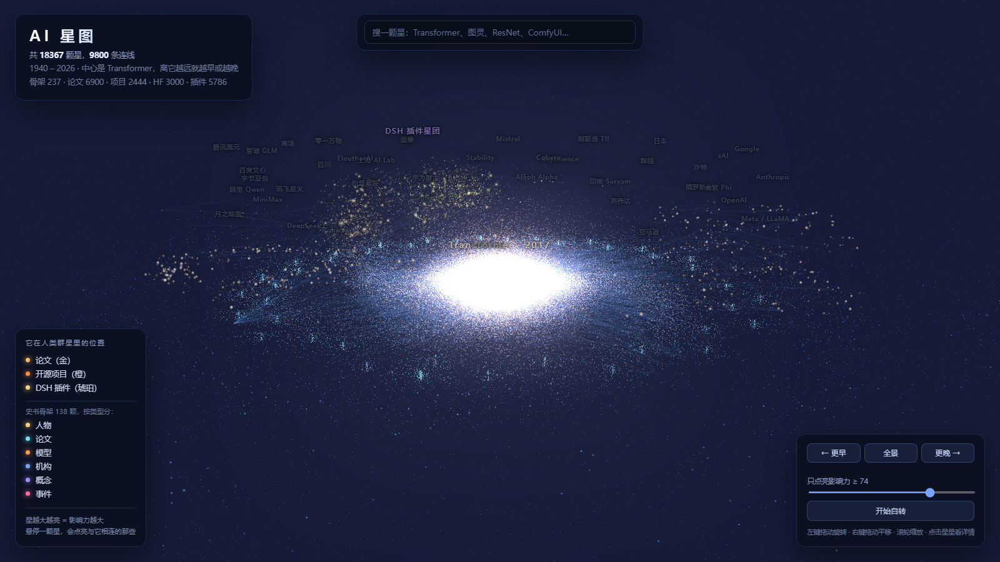

# AI 星图 · AI Galaxy

**把人工智能八十年的历史，画成一片可以飞进去的星系。**

每颗星是人、论文、模型、机构或事件；星越大越亮，说明它越重要；星与星之间的细线，是「谁引出了谁」。中心是一颗黑洞，那是 Transformer。

[](https://lk2168.github.io/ai-galaxy/)
[](LICENSE-DATA)
[](LICENSE)



---

## 这是什么

这不是一张时间线。

时间线只能把事情排成一队，但 AI 这八十年不是一个接一个发生的——很多人同时在试不同的路，有的路走通了，有的走进死胡同，有的被冷落三十年又被重新捡起来。**一张排成一列的图装不下这些。**

所以这里是一张星图：

| 你看到的 | 它代表 |
|---|---|
| **中心的黑洞** | Transformer。所有现代大模型都建在它上面，它是引力源 |
| **离中心越近的星** | 影响力越大。图灵、AlexNet、ChatGPT 贴着核心，一篇被引 30 次的论文在外圈 |
| **旋臂** | 流派。符号主义、连接主义、统计学习、深度学习各有各的方向 |
| **外围的一颗颗小星团** | 40 个模型家族。OpenAI、DeepSeek、阿里 Qwen、Mistral……每个家族里内圈是它的历史模型，外圈是它的生态项目 |
| **左边那团金色** | 5786 个 DeepSeek Harness 插件。它挂在 DeepSeek 家族旁边，因为它就是从这个生态里长出来的 |
| **悬在最外层的星** | AI 史上的人。图灵、辛顿、李飞飞——他们不在主盘里，因为主盘讲的是「东西」，人不是东西 |

**一句话**：这不是知识库，是一张可以看很久的图。

---

## 现在的规模

| 层 | 数量 | 来源 | 亮度依据 |
|---|---|---|---|
| 史书骨架 | 237 | 手工整理，每条带简介与来源链接 | 社群评估（**主观**，见下） |
| 论文 | 6,900 | [Crossref](https://api.crossref.org/) | 同年份段的被引百分位 |
| 开源项目 | 2,444 | GitHub 14 个主题、star > 400 | star 数 |
| HuggingFace 模型 | 3,000 | [hf-mirror](https://hf-mirror.com/api/models) | 下载量 |
| DSH 插件 | 5,786 | [awesome-dsh-plugin](https://awesome-dsh-plugin.com/plugins.json) | 下载量 |
| **合计** | **18,367 颗星、9,800 条连线** | | |

> ⚠️ **诚实说明**：只有「史书骨架」里的影响力是人工评估的，**没有客观标准**。论文、项目、模型的亮度来自被引量、star 数、下载量——是真实的，但也只说明「被用得多」，不等于「重要」。你觉得哪颗星画大了，欢迎提 PR 改。

---

## 怎么用

**直接看**：https://lk2168.github.io/ai-galaxy/

| 想干什么 | 怎么做 |
|---|---|
| 转 | 左键拖动 |
| 移动 | 右键拖动 |
| 钻进去 | 滚轮（朝鼠标位置推进） |
| 找东西 | 顶部搜索框，点结果镜头会飞过去 |
| 看一颗星跟谁有关 | 悬停，它和它的邻居一起亮，连线变成暖白光束 |
| 只看一家公司 | 点它的家族标签（比如「阿里 Qwen」），按 ESC 退出 |
| 只看重要的 | 右下角滑块往右拖 |
| 分享某颗星 | 点开一颗星，地址栏会变成 `#node=xxx` |

**本地跑**：

```bash
pnpm install
pnpm dev          # http://localhost:5173
```

---

## 怎么加一颗星

这是最重要的一节。**你不需要会写代码**，只要会改文本文件。

### 第一步：找到位置

```
data/nodes/
├── 1940s.yaml ~ 2020s.yaml   按年代分（人、模型、事件、概念）
├── families.yaml             各家模型家族的历史模型
├── families-global.yaml      全球其他厂商
└── ecosystem-cn.yaml         中国厂商的应用产品
```

### 第二步：照着写一个节点

```yaml
- id: transformer            # 小写英文，全局唯一，用连字符
  type: paper                # person | paper | model | org | concept | event | project
  name: Transformer
  year: 2017
  weight: 99                 # 0-100，影响力
  summary: 只用注意力，不用循环。训练可以完全并行，于是模型能堆到前所未有的规模。
  tags: [模型, 架构, 里程碑]
  sources: ["https://arxiv.org/abs/1706.03762"]   # 至少一条能打开的来源
```

想加到某个模型家族里，再加一行 `family: deepseek`（可选值见 `src/galaxy/layout.ts` 的 `FAMILIES`）。

### 第三步：连线

在 `data/links.yaml` 里加：

```yaml
- { source: transformer, target: attention-mechanism, relation: 奠基, strength: 5 }
```

`relation` 可选：`提出 奠基 继承 改进 取代 合作 发布 推动 影响 竞争 反驳`
`strength`：1-5，线越粗越亮。

### 第四步：自检 + 提 PR

```bash
pnpm check:data    # 校验格式、id 唯一、连线两端都存在
pnpm export        # 转成前端读的 JSON
pnpm dev           # 本地看效果
```

校验过了就提 PR，CI 会再跑一遍同样的检查。

---

## 三条我们想守住的东西

**一、来源必须能打开。** 每个节点的 `sources` 至少一条真实链接。写不出出处的东西，不进这张图。

**二、不假装客观。** 人工评估的影响力标注为「社群评估」，客观数据（引用、star、下载）也写明它只代表「被用得多」。两者不混为一谈。

**三、宁可少，不要错。** 编一个不存在的模型、写错一年的年份，比少一颗星糟得多。这张图的可信度就是它的全部价值。

---

## 路线图

- [x] 单中心黑洞 + 40 个模型家族星团
- [x] 搜索、悬停高亮、家族视图、永久链接
- [x] 五项数据源接入（Crossref / GitHub / HuggingFace / DSH 插件）
- [ ] **把数据量拉到 10 万+**（arXiv 全量，接口已通）
- [ ] 时间轴滑块：拖动看星系生长
- [ ] 手机端适配
- [ ] 把「影响力」的评估过程公开成讨论帖

---

## 技术栈

Vite + React + TypeScript + three.js。**纯静态**：没有后端、没有数据库、没有账号。数据是仓库里的 YAML，构建时转 JSON，GitHub Actions 校验并部署到 Pages。

星系布局照抄了 [诗云 Poetry Cloud](https://github.com/Cohenjikan/shiyun) 的算法（旋臂 + 中心模糊 + 三层星云），这是本项目视觉上最大的参考。

## 许可

- **代码**：[MIT](LICENSE)
- **数据**：[CC BY 4.0](LICENSE-DATA) —— 可以转载、可以二次创作，署名即可

## 贡献者

<a href="https://github.com/lk2168/ai-galaxy/graphs/contributors">
  
</a>

---

<sub>如果你也觉得「AI 的历史值得被画成一片星空」，欢迎加一颗星。</sub>
